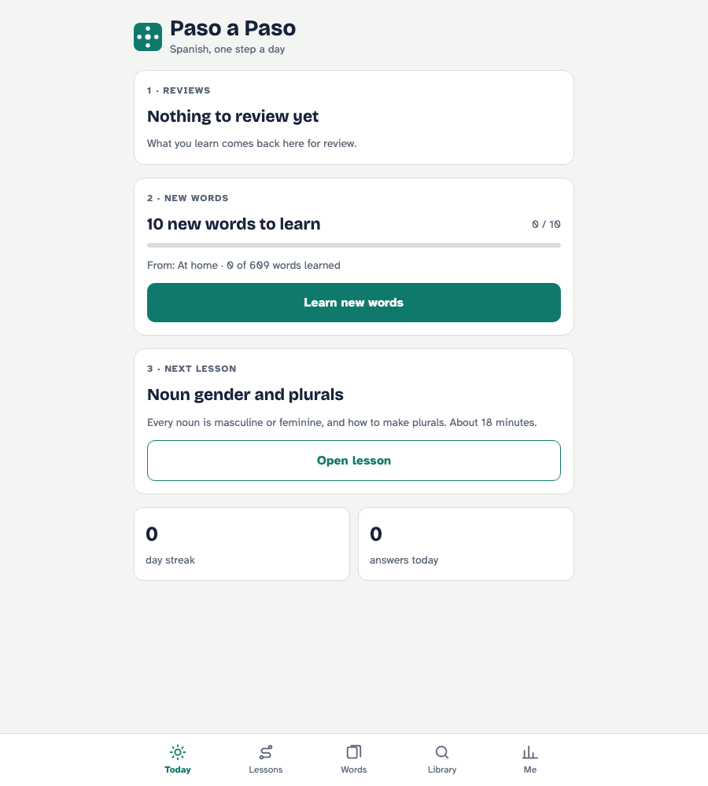

# Paso a Paso: a Spanish course app

A phone-first Spanish (Spain) course for complete beginners, A1 towards A2.
It combines grammar lessons, a spaced-repetition review deck, verb tables and
speaking practice, with no account and no backend.



**Live demo:** https://paso-a-paso-khaki.vercel.app

Built by [Luke Harper](https://github.com/lukeharper1990-oss) for learning
alongside a language school, then structured so the content is separate from
the app and anyone can swap in their own.

## What it does

- **Today:** the review cards due today, a daily new-word quota, and the next
  lesson, so there's always one obvious thing to do
- **Lessons (14 at A1):** the rule explained first with clear grammar tables,
  then 15 to 20 exercises applying it, then sentence translation. Each lesson
  is 10 to 15 minutes, not a 2-minute streak game
- **Words (600+ across 14 themes):** articles always shown, plurals included,
  adjectives in all four forms
- **Verbs:** one tense at a time per verb card, irregulars flagged
- **Speaking:** text-to-speech for every word, and speech recognition for
  answering out loud (best in Chrome on Android)
- **Strict but fair marking:** missing accents pass with a warning, and a
  "Don't know" button shows the answer without guessing
- **Spaced repetition:** words, verb tables and exercises come back just
  before you'd forget them

## Product decisions

- **No account, no backend.** Progress lives in the browser's local storage,
  with a manual backup file. Zero setup and nothing to maintain, at the cost of
  no cross-device sync, which a single phone doesn't need.
- **Content as data.** Every lesson, word list, phrase set and verb is JSON in
  `content/`, so new lessons are a file, not a code change.
- **Lessons from class.** Lessons in `content/lessons/class/` show at the top
  and as "Next" on Today, so the app can follow whatever was taught that day.
- **Tests guard the content.** `tests/content.test.js` checks that every word
  a lesson uses exists, every verb has its forms, and every exercise has an
  answer, so a typo in a JSON file fails the build instead of a lesson.

## Project structure

```
index.html, app.js, styles.css   app shell and screens
core.js                          pure logic: grading, noun/adjective forms, scheduling
content/index.json               which lesson packs and class lessons to load
content/lessons/a1.json          the A1 course
content/vocab.json               themed word lists
content/verbs.json               verb tables
content/phrases.json             phrase sets
tests/                           node:test suites for logic and content
```

## Running it

It's a static site. Serve the folder with any web server:

```
python3 -m http.server 8000
```

Then open http://localhost:8000. Deploy anywhere that serves static files
(the demo is on Vercel).

## Tests

```
node --test tests/*.test.js
```

## Adding a lesson

1. Create `content/lessons/class/YYYY-MM-DD-topic.json` with the same fields
   as a lesson in `content/lessons/a1.json` (title, summary, body, rule
   exercises, words, verbs, sentences, optional `newWords`)
2. Add its path to `classLessons` in `content/index.json`
3. Run the tests
